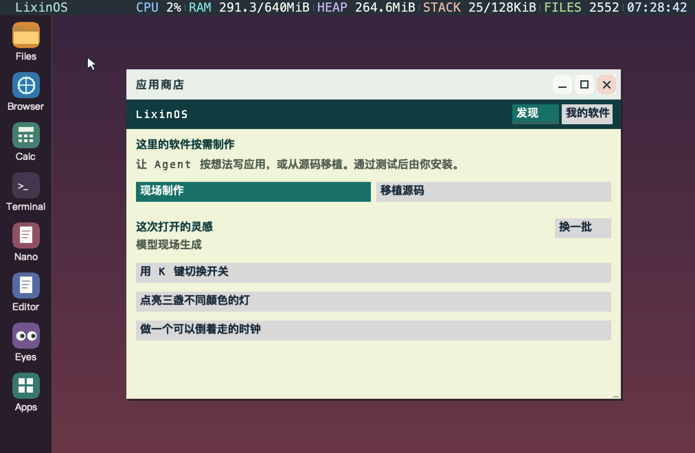

# 应用商店

在图形终端运行 `desktop`，打开 **Apps → 系统 → 应用商店**。这里的软件按需制作。想做一个新工具，点「现场制作」；想把已有程序搬到 LixinOS，点「移植源码」。

## 从点子到桌面

1. 每次打开商店，首页先用本机规则组合三个点子，同时请求模型生成三个新点子。模型回复通过校验后，来源会变成「模型现场生成」。点「换一批」可再选。选择一条会把它放进可编辑的需求框。
2. 点「交给 Agent」才会创建项目并开始制作。移植时再提供系统内 C 源码的绝对路径或 HTTPS 原始文件链接。当前工作台支持单个不超过 32 KiB 的 UTF-8 C 文件。上游原件、来源和 SHA-256 保存在项目里。
3. Agent 修改代码和回归测试，用系统内的 TCC 编译窗口程序。在项目页可以「继续 Vibe」或「运行测试」。通过测试后，点「安装此版本」核对操作，再点「确认安装」。重新打开 Apps 就能在「其他」看到对应的 `.win2` 程序。
4. 在「我的软件」打开作品，可以改出下一版、回滚到上一版，也可以卸载。卸载只移除该作品的菜单程序和安装记录，项目源码、测试和历史版本仍在。另行安装的系统包会显示安装清单和命令入口，由各包原有的安装器维护。

模型连接沿用 LixinOS Agent 的启动配置。没有模型时仍可浏览与修改点子、导入源码、管理已有作品。制作任务会保留草稿，恢复连接后点「继续 Vibe」可重试。最近一次制作的输出保存在项目的 `.desktop/store.log`。商店项目位于 `/work/store/`，每个新需求都有独立目录。



## 在另一块日常盘安装

在 Mac 的仓库根目录运行下面三条命令，最后一个参数换成已关机的目标盘。安装器在同一次磁盘提交中更新窗口程序、桌面菜单和 Agent 用户态入口。

```sh
bash User/netsurf/build.sh
bash User/app-store/build.sh
python3 User/app-store/install.py "$HOME/Library/Application Support/LixinOS/daily.img"
```

模型点子需要支持用户态桌面 Agent 的内核。双内核测试使用 `kernel-2026-11-21.24`。要在工作盘的临时副本上验证移植、编译、安装、回滚和卸载，可运行以下命令。测试使用固定模型回复，通过 QEMU 的模型桥传送。

```sh
python3 scripts/test-app-store.py --kernel rust --disk "$HOME/Library/Application Support/LixinOS/daily.img"
python3 scripts/test-app-store.py --kernel tcc --disk "$HOME/Library/Application Support/LixinOS/daily.img"
```
