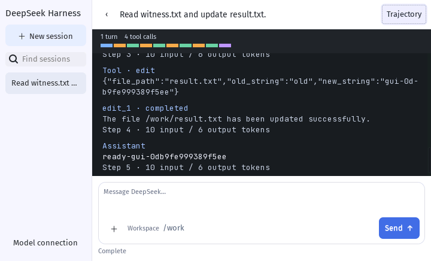

# DeepSeek Harness on LixinOS

The guest shell command `dsh` starts the upstream DeepSeek Harness CLI 0.2.1-rc.5 with the guest's ARM64 Node executable. Build the user package on the workstation with npm, Python 3, and the project's AArch64 cross compiler.

```sh
python3 User/dsh/package.py Kernel/target/dsh-port/dsh-release
python3 scripts/test-dsh.py --headless --package Kernel/target/dsh-port/dsh-release \
    --node /path/to/openssl-node-package --disk /path/to/test-seed.img
```

The packaging script verifies the upstream CLI tarball and uses the npm lockfile to install the base and headless bundles. The test makes a disposable copy of the supplied disk. To install the package, use the offline package installer with a powered-off volume. Install the Node package on the same volume.

```sh
python3 User/gcc/install.py --toolchain node /path/to/openssl-node-package /path/to/disk.img
python3 User/gcc/install.py --toolchain dsh Kernel/target/dsh-port/dsh-release /path/to/disk.img
```

## LixinOS 原生图形客户端



在 LixinOS 图形桌面的 **Apps → 其他** 打开 **dsh-gui.win3**。左栏可以新建、搜索和重开图形客户端里的会话。选择 **Workspace** 输入 guest 中已有目录的绝对路径，在输入框中写任务，点击 **Send** 或按 **Ctrl+S** 发送，Enter 换行。**＋** 将选中的文件路径放进输入框，供引擎使用其文件工具读取。

聊天区使用 Markdown 排版实时回复和历史消息，包括标题、列表、表格、引用和代码块。点击蓝色下划线的来源标题或网页地址可在桌面的 NetSurf 浏览器打开原文。连续的网页搜索和抓取汇总为一行。

**Trajectory** 展开当前会话的执行记录，包括工具参数、结果、错误和引擎报告的 token 用量。点击时间线上的色块可跳到对应的提问、工具调用、结果或回复，再次点击 **Trajectory** 返回聊天。**Stop** 向当前 Agent 发出取消请求；引擎完成清理后可以继续同一会话。窗口复用 `dsh headless`、工作目录和会话 ID。会话原始数据由 DSH 保存；窗口把可显示的轮次记录放在 `$DSH_HOME/lixinos-gui/turns`。侧栏只列出通过此客户端建立的会话。

**Model connection** 可为当前窗口设置 API 端点和密钥，下一次发送时生效。密钥留在进程环境中。使用共享 API 密钥时，网页搜索会沿用窗口、启动环境或用户配置里的 DeepSeek 聊天地址，自动补齐 `/v1`。代理需要支持 Messages 的原生 `web_search_20250305` 工具和非流式 JSON 响应。需要独立搜索地址时，设置 `DEEPSEEK_SEARCH_BASE_URL`（包含版本路径）或插件的 `baseURL`。聊天区显示搜索的完成或失败状态，具体来源和错误可在 **Trajectory** 中查看。需要跨次启动沿用的配置，按下文配置 guest 的 DSH 环境。客户端用 GTK 3 和 Win3 绘图，带一个仅在图形会话加载的 Cordis 扩展，用于流式文本和停止请求。上游插件创作界面未移植。

在已装有 GTK 3 字体资源、支持 OpenSSL 的 Node 和 DSH 的工作盘上安装图形客户端。安装程序需要工作盘处于关机状态。

```sh
bash User/dsh/gui/build.sh
python3 User/gcc/install.py --toolchain dsh-gui Kernel/target/user-build/dsh-gui/package data/shared.img
```

在主机上运行 `python3 scripts/test-dsh-gui.py --kernel rust` 或 `--kernel tcc` 可在临时盘中驱动真实窗口并调用本地模型测试端点。加上 `--screenshots 目录` 可保存 guest 的窗口画面。

For a model request, install the [OpenSSL build of Node](../node/README.md). In the guest, choose a writable `DSH_HOME`. DSH reads `DEEPSEEK_API_KEY` from its inherited environment or from `$DSH_HOME/.env`. Use the guest shell from the directory containing the file you want DSH to read.

```sh
export DSH_HOME=/scratch/dsh-user/.dsh
export DEEPSEEK_BASE_URL=https://api.deepseek.com/anthropic
dsh headless 'Read witness.txt and reply with its contents.'
```

The automated headless test runs without credentials. Its local Messages fixture checks a file read, an exclusive create, an edit, and the preceding conversation and tool results in a new process. It also runs a foreground shell command in an isolated guest and checks its output file on the primary volume.

Use the Node 22 OpenSSL build linked with the current LixinOS adapter for headless sessions. For example, start a task with `dsh headless --json 'Read brief.txt'`, then reuse the returned ID with `dsh headless --session-id SESSION_ID 'Implement that change'`. Earlier logs that were already truncated can only be recovered from an intact copy.

Foreground shell commands run in a disposable, networkless LixinOS VM. On custom disk launches, set `LIXINOS_CODEX_SHELL=1` on the Mac before starting QEMU. The worker copies a project directory (up to 1,024 entries and 8 MiB) into `/workspace`. Use project-relative test paths. Hidden entries and the DSH configuration directory are excluded. In workspace-write mode the guest publishes successful filesystem transactions after checking for concurrent edits. A command's exit code and output are returned even if its tests fail. Read-only mode rejects attempts to publish changes. Background shell jobs are unsupported.

The base Node 22.23.5 port runs `dsh --help` and `dsh --version`. The headless profile requires Node compiled with OpenSSL. The launcher enables internal module resolution in its own Node process for the Cordis plugin loader. On V8 Lite, DSH uses a Fetch implementation backed by Node's HTTP and HTTPS modules. Interactive TUI, web, plugin installation and desktop profiles are outside the tested package.

The JSONL session writer uses exclusive file creation for a writer claim. It releases the claim on normal session close. If the guest loses power, an existing session may retain a `session.lock.exclusive` file. To recover that session, remove its claim with all writers stopped. Fresh sessions use distinct directories.
