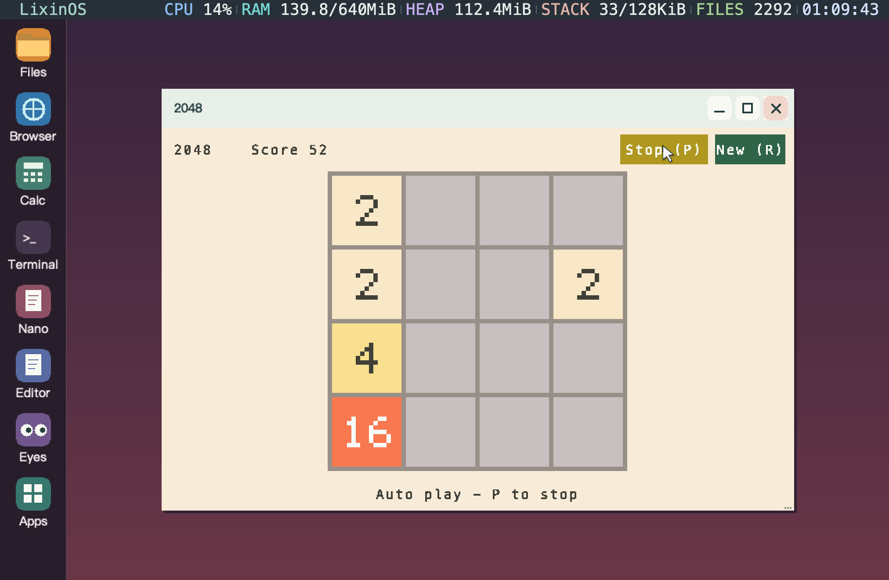
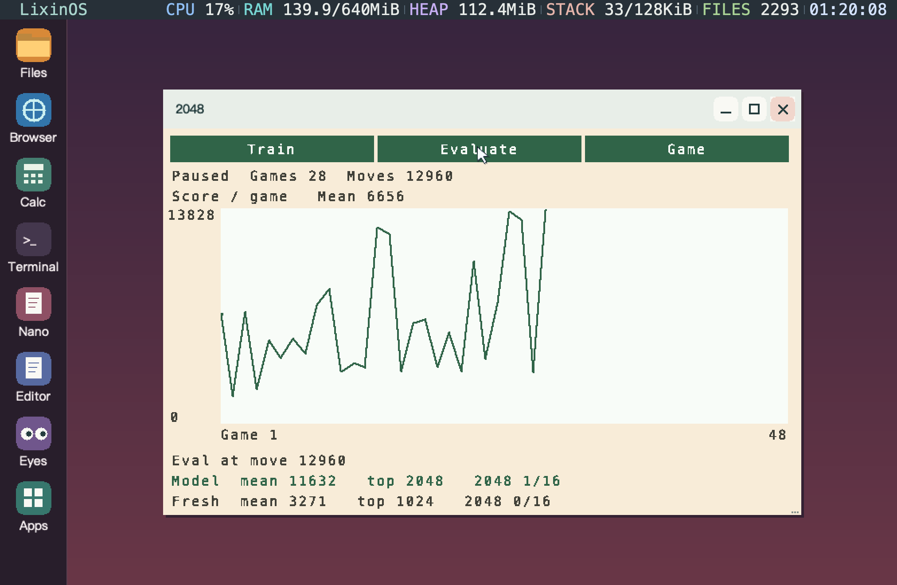

# 2048 桌面版

在 LixinOS 输入 `desktop`，打开 **Apps → 游戏 → 2048**。用方向键、WASD 或在棋盘上拖动鼠标来滑动方块。两个相同的数字相撞时会合并，合并出的数字计入分数。只有有效移动才会生成新方块。每步先用 100 毫秒滑动，再用 40 毫秒显示合并和新方块。动画期间可以提前输入下一步。拼出 2048 后可以继续挑战。按 **R** 或点击 **New (R)** 重新开局，按 **Q** 或关闭窗口退出。

点击 **Auto (P)** 或按 **P** 启动自动模式，再按一次暂停。按方向键、WASD 或拖动棋盘可以立即接管。自动模式会比较合法方向，枚举空格中出现 2 或 4 的可能，选择预期局面评分最高的一步。空格多时向前看两步，剩五格或更少时看三步。评分考虑空格、相邻可合并方块，以及大数能否保持有序。每次随机出块后都会重新计算。

游戏逻辑取自 Maurits van der Schee 的 [2048.c 1.0.3](https://github.com/mevdschee/2048.c/tree/90343eb209e84fa9687d596f5d5eecfdf7d4df51)，保留了移动、单次合并、计分和终局判定。窗口、数字绘制、输入和随机出块接入 LixinOS 用户态接口。[MIT 许可证](LICENSE)



## 在线强化学习

点击 **Learn** 或按 **L** 打开训练面板。**Train** 开始现场自对弈，**Pause** 随时暂停或按空格切换。策略从零权重开始，以合并得分为奖励，每走一步就使用这次经验更新局面价值。训练时有 5% 的概率探索随机合法方向。顶部显示已完成局数和采集的步数，折线从左到右依次绘出最近 48 局的真实得分，Mean 是这些局的平均分。

点击 **Evaluate** 或按 **E** 会暂停学习，在 16 个固定种子上各跑一次当前模型（Model）和零权重基线（Fresh）。两者都关闭探索。结果显示平均分、最高方块，以及达到 2048 的局数。训练用的棋盘和随机数状态会保留，评估结束后可以继续训练。评估途中可再次按 **E** 取消。重复评估同一个模型会得到相同结果。

暂停、开始评估、返回游戏、正常关闭窗口及每完成 128 局时都会保存进度。模型、未完成的训练对局和历史得分保存在客机的 `/home/lixin/.2048-learning`。没有主目录的精简测试盘会使用 `/.2048-learning`。重新打开 **Learn** 会从检查点恢复，点击 **Train** 即可续训。**Game** 返回原来的手动棋盘。



## 构建与安装

在 Mac 的项目根目录运行以下命令。构建脚本从桌面盘创建临时副本，在 QEMU 客体内调用 TCC 生成 LXE1 程序；安装命令把程序、源码和许可证写入已关机的目标盘。

```sh
disk="$HOME/Library/Application Support/LixinOS/daily.img"
python3 User/games/2048/build.py "$disk" --release kernel-2026-11-21.19
python3 User/gcc/install.py --toolchain 2048 Kernel/target/user-build/2048-package "$disk"
```

安装后也可以直接在 LixinOS 里修改源码、重新编译，再从 Apps 打开新版本：

```sh
tcc /lib/2048/game.c -o /bin/2048.win3
```
