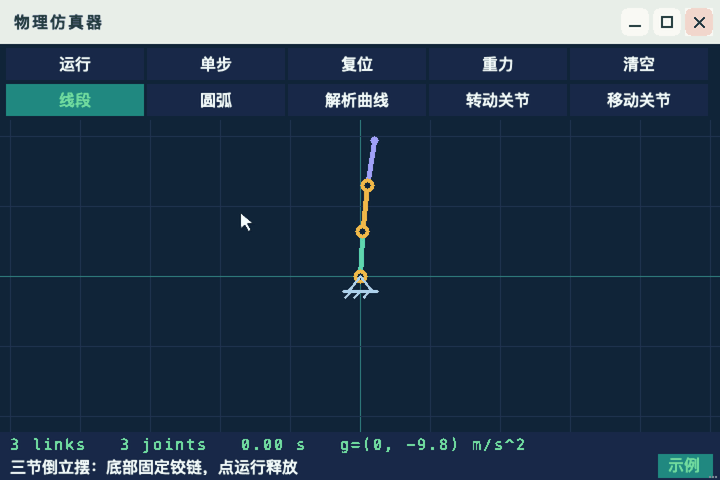
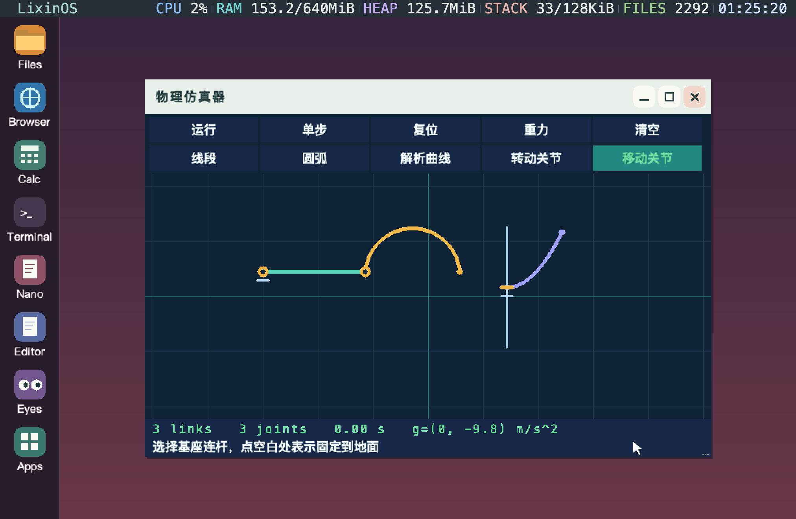
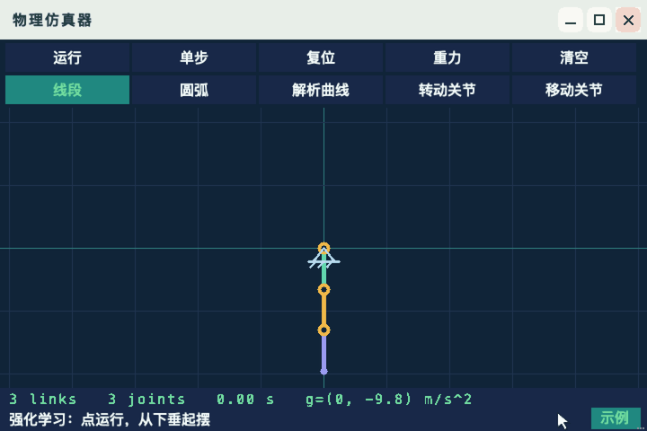

# 二维物理仿真器

在 Desktop 打开 **Apps → 工具 → 物理仿真器**。初始场景为三节倒立摆。三根 0.65 米的刚杆串联，底部通过转动关节铰接在地面原点，另两个转动关节连接相邻杆端。三根杆从静止释放，相对竖直方向分别向右倾斜 3°、6°、9°。右下角 **示例** 可重新载入三节倒立摆或切换到原来的单摆。点 **运行** 或按空格启动，再点一次暂停。**单步** 推进 1/120 秒，**复位** 回到建模姿态。要从空场景开始，点击 **清空** 并再次确认。



| 工具 | 画布上的操作 |
| --- | --- |
| 线段 | 点击两个端点，或从起点拖到终点。 |
| 圆弧 | 依次点击起点、弧上的中间点和终点。中间点决定取哪一段弧。 |
| 解析曲线 | 点击局部坐标原点，填写 `x(t)`、`y(t)` 和参数上下限。 |
| 转动关节 | 先点基座连杆（点空白处选地面），再点另一根连杆上的锚点。锚点重合，允许相对旋转。 |
| 移动关节 | 选择基座和锚点后，再点一个位置确定滑动轴。轴跟随基座转动，两根连杆保持相对角度。 |
| 重力 | 修改世界坐标中的水平和竖直分量。y 轴向上，默认 `gx=0`、`gy=-9.8`，单位 m/s²。 |

网格间距为 1 米。滚轮以指针位置为中心缩放。Esc 取消正在取点的操作或关闭公式窗口。选择建模工具会复位已有机构，以初始姿态添加新的约束。

表达式支持十进制常数、参数 `t`（也可写作 `x`）、`pi`、括号、四则运算、幂 `^` 以及 `sin`、`cos`、`tan`、`sqrt`、`exp`、`log`、`abs`。角度使用弧度。例如抛物线可填 `x(t)=t`、`y(t)=t^2`，范围填 `-1` 到 `1`。公式应在整个参数区间内连续且有定义。

每条曲线是一根刚性细杆，线密度为 1 kg/m。圆弧和参数曲线按 96 段离散，按各段长度计算总质量、质心和转动惯量。求解器使用固定时间步和迭代关节约束。场景支持 40 根连杆和 80 个关节。连杆可以互相穿过；“地面”用于固定关节，场景没有碰撞地板。



## 强化学习起摆

**示例 → MuJoCo 三节起摆** 用 MuJoCo 4.0.1 运行与「强化学习起摆」相同的冻结策略。两个示例都从静止下垂开始；首次连续稳住两秒后，面板记录确认时刻。MuJoCo 每个控制周期推进四个 RK4 物理步。[移植与验证](../mujoco/README.md)

打开右下角 **示例 → 强化学习起摆**。三根杆从竖直下垂、速度为零的状态开始。点 **运行** 后，策略以 120 Hz 读取三根杆的角度和角速度，给三个转动关节施加力矩。底座、中间和末端电机的力矩上限分别为 16、8、3 N·m。连续两秒三根杆都与竖直向上的夹角不超过 5°，且各自角速度不超过 0.20 rad/s，面板显示「已稳住」。**复位** 可以从下垂姿态再次起摆。改变机构拓扑后会转回普通物理仿真。

**示例 → 3 节策略 … 10 节策略** 收录了两批实验的全部 36 个策略。每行显示训练种子编号、实际训练轮数和 32 个独立扰动测试的通过数。7–10 节可以对照同一种子的 300 轮和 1,200 轮版本。选定后点 **运行**，每次从完全下垂静止开始，**空格** 暂停或继续，**单步** 推进一个物理步，**R** 复位。测试分数是历史记录，运行时的「已稳住」按当前姿态判定。复现全部实验权重可运行 `python3 User/physics/benchmark/export-presets.py > /tmp/swing-presets.h`。

策略在宿主机上的同一个刚体求解器里训练。交叉熵方法每轮在 8 秒仿真中评估 56 个反馈策略，以接近直立、低角速度、低力矩和稳定保持作为回报，用回报最高的 9 个更新采样分布。冻结策略在 32 个独立初态（三根杆各自相对下垂方向随机偏转 ±10°）上均通过了末尾连续两秒的稳定判定。该评估使用示例的杆长、质量和重力。



要复现训练，在项目根目录执行：

```sh
cc -O3 -std=c11 User/physics/train-swing.c -lm -o /tmp/lixin-train-swing
/tmp/lixin-train-swing > /tmp/swing-weights.h
```

## 构建与安装

使用仓库现有的 AArch64 musl 工具链，在项目根目录运行：

```sh
bash User/physics/build.sh
python3 User/gcc/install.py --toolchain physics Kernel/target/user-build/physics-package /path/to/offline-disk.img
```

数值回归测试可直接在宿主机运行：

```sh
cc -std=c11 -O2 User/physics/test.c -lm -o /tmp/lixin-physics-test
/tmp/lixin-physics-test
```
