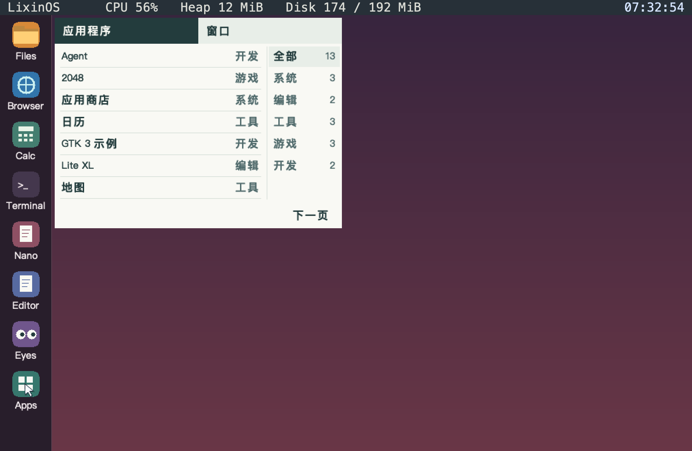

# LixinOS 应用清单

在图形终端输入 `desktop`。常用入口固定在左侧 Dock，点 **Apps** 打开应用程序菜单。在菜单右侧选分类，左侧点名称即可启动。分类旁的数字是这块盘上可用的条目数。「全部」超过一页时可点底部「下一页」。要找回已打开或最小化的窗口，点菜单顶部的「窗口」。

## 桌面应用

下表按 2026-11-21 核对的日常工作盘整理。新安装到 `/bin` 的 `.win`、`.win2`、`.win3` 程序会在下次打开菜单时出现，自编应用如果还没有分类，会显示在「其他」。

| Apps 分类 | 菜单中的名称 | 用途 |
| --- | --- | --- |
| 系统 | 应用商店、系统设置、任务管理器 | 按需制作或移植应用，调整系统设置，查看进程和资源占用 |
| 编辑 | Lite XL、Mousepad | 用 Lite XL 编辑代码，用 Mousepad 打开或修改文本 |
| 工具 | 日历、地图、秒表 | 浏览月份、查看地图、计时 |
| 游戏 | 2048、数字拼图、Eyes | 合并数字方块、匹配拼图边缘，或看一双跟随指针的眼睛 |
| 开发 | Agent、GTK 3 示例 | 打开 Agent 面板，或试用 GTK 控件；首次启动 Agent 时系统会用 TCC 构建它 |

## 在应用商店做新软件

打开 **Apps → 系统 → 应用商店**，选择现场生成的点子，改成自己的需求，再点「交给 Agent」。有现成的单文件 C 源码可以选「移植源码」。通过测试的作品可安装到 Apps，也可以在「我的软件」继续迭代、回滚或卸载。[商店使用说明](../User/app-store/README.md)

## Dock 快捷入口

| 入口 | 用途 |
| --- | --- |
| Files | 浏览和管理文件，双击文件打开关联应用 |
| Browser | 用 NetSurf 浏览网页。也可以在 Bash 输入 `netsurf https://www.apple.com.cn/` |
| Calc | 打开计算器 |
| Terminal | 打开终端运行命令 |
| Nano、Editor | 打开 Nano 或图形文本编辑器 |
| Eyes | 打开 Eyes，已有窗口时切回它 |
| Apps | 按用途找程序，或切换到已打开的窗口 |

## 从 Bash 启动

| 想做什么 | 可以运行 |
| --- | --- |
| 编辑文本或代码 | `nano hello.c`、`kilo hello.c`、`dte hello.c`，或 `text-editor hello.txt` |
| 绘制矢量图 | 在图形终端运行 `paint sketch.svg` |
| 玩贪吃蛇 | `python /src/games/snake.py` |
| 在终端浏览网页、连接远程机器 | `links`、`links2`、`ssh`、`sftp` |
| 编译与版本管理 | `tcc` 编译 C，`lust` 编译它支持的 Rust 子集，`git` 查看改动、提交和查询历史 |
| 运行 Python | `python` 启动 MicroPython，`python3` 启动 CPython，`pip`、`pip3` 管理 CPython 包 |
| 查看系统状态 | `htop`、`ps`、`sysinfo`、`cpuinfo`、`netinfo`、`df`、`du`、`uname` |
| 管理和查找文件 | `ls`、`tree`、`find`、`stat`、`cp`、`mv`、`mkdir`、`rm`、`touch` |
| 搜索、比较或处理文本 | `cat`、`grep`、`sed`、`diff`、`cmp`、`head`、`tail`、`sort`、`uniq`、`wc` |

在自己的盘上运行 `ls /bin` 可以查看已安装的程序文件。Dock 的计算器等内置窗口由 `desktop` 提供。系统操作示例见[系统手册](README.md)，窗口协议和自编应用的安装方式见[桌面开发说明](../User/desktop/README.md)。
